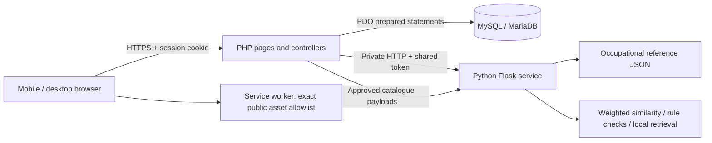
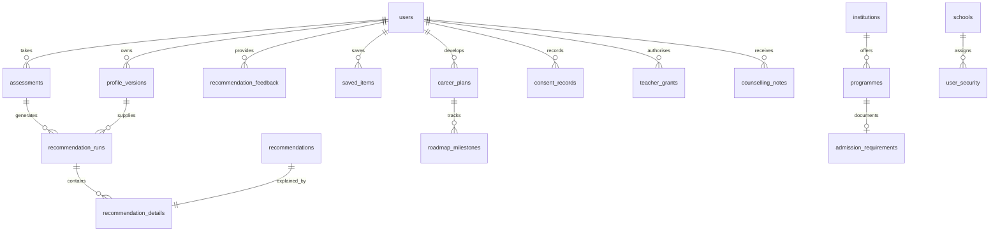

# Technical implementation — Chapter 4 evidence

Implementation reference: 27 October 2026. This document describes code in this package, not proposed research findings.

## Architecture and technology

The existing multi-page PHP architecture is preserved. HTML/CSS provide the branded interface; small vanilla JavaScript modules handle mobile navigation, assessment progress, busy states and chat. PHP owns identity, CSRF, authorisation, validation, database transactions and report downloads. Flask has no learner database credentials and persists no learner records. PHP sends only required scoring fields, public catalogues or minimal assistant context. MySQL is the authoritative store for accounts, historical guidance, schools, sharing grants and published directory content.

Docker uses MySQL 8.4, PHP 8.3/Apache and Python 3.11/Gunicorn. The local verification environment used XAMPP PHP 8.0.30, MariaDB 10.4 and a separate Python virtual environment. The runtime needs PDO MySQL, cURL, mbstring and iconv. Python dependencies are specified in `ai_engine/requirements.txt`; tests use `tests/requirements.txt`.

## Actors and implemented use cases

| Actor | Actions | Enforced boundary |
|---|---|---|
| Visitor | Read source-labelled education/funding directory, privacy notice and offline guide; register/request recovery | No private profile, plan, recommendation or PDF |
| Learner | Profile, assessment, recalculation, history, feedback, comparison, eligibility, scenarios, favourites, roadmap, PDF/JSON exports, teacher grants, deletion | Every private record query is scoped to session user ID |
| Teacher/counsellor | Assigned-school aggregate trends and CSV; consented individual profile/results; notes and follow-up actions | Confirmed matching school + teacher role + active learner-specific grant checked on each request |
| Administrator | Statistics, registered schools, non-admin role assignments, staged content revisions, reviews, audit/configuration health | Cannot self-change role or appoint an admin through web; publication requires a different reviewer and password confirmation |
| Trusted operator | Migration, administrator appointments, retention, backups and recovery | CLI scripts reject HTTP; production access must be restricted by OS and DB permissions |

## Functional requirements and module mapping

| Requirement | Actual implementation |
|---|---|
| Optional detailed learner information | `profile.php`, `profile_payload()`, `profile_versions` |
| Interest assessment and history | `assessment.php`, `riasec.py`, `/score`, `history.php`, `assessment_responses` |
| Transparent career suggestions and recalculation | `model.py`, `/recommend`, `recalculate.php`, `save_run()` |
| Education and funding provenance | `directory.php`, `scholarships.php`, three directory tables, source JSON, `content_submissions` |
| Prerequisite checking and scenario comparisons | `eligibility.py`, `/eligibility`, `/simulate`, `eligibility.php`, `simulate.php` |
| Career comparison | `/compare`, `compare.php`, reviewed career supplements where available |
| Plans, saved options and activities | `progress.php`, `roadmap.php`, `saved_items`, `career_plans`, `roadmap_milestones` |
| Guidance exports | `report.php`, dependency-free paginated PDF writer; account JSON and teacher aggregate CSV |
| Source-linked assistant | `chatbot.py`, `/chat`, `chat_api.php`; approved DB catalogues passed per request |
| Educator and administration | `teacher.php`, `admin.php`, `account.php`, `security.php`, `admin_helpers.php` |
| Language/accessibility/offline | `translations/`, `i18n.php`, CSS/JS, public `offline.html`, manifest and service worker |

## Database design

Original tables remain: users, learner_profiles, assessments, recommendations, careers and assessment_questions. The legacy `careers` table is retained for compatibility; the international matching reference remains JSON. `career_catalogue` holds reviewed supplementary career content and does not silently alter interest vectors. `scholarships` stores funding records and `content_submissions` records proposed/reviewed revisions. `account_tokens`, `rate_limits`, `audit_logs`, `schools`, `user_security`, `teacher_grants` and `consent_records` support security. `schema_migrations` records checksums and application dates.

Directory tables use stable string identifiers, institution foreign keys, indexed verification status and JSON text payloads for source-specific optional fields. `admission_requirements` mirrors the structured rule payload on publication. Profile snapshots and recommendation payloads are stored as JSON text rather than overwriting history. These fields are deliberately schema-flexible; PHP/Python validate structures because cross-version MySQL/MariaDB JSON constraints differ.

New recommendations have a foreign-key path to their assessment and profile snapshot. Legacy recommendations are preserved, but unknown original associations are not fabricated. User deletion cascades learner records; audit actors are de-identified. School reassignment revokes grants. Dates displayed as stored event timestamps are UTC; funding date decisions use Lesotho time.

Migration files are additive and checksum-tracked. MySQL DDL auto-commits: backup/restore, not a fictitious rollback transaction, is the recovery mechanism. Seed inserts preserve existing operator-edited records. Migration tests exercise a copy of the original schema from the ZIP, legacy account/recommendation survival, repeated execution, non-overwriting seeds, reference lengths and foreign keys.

## Recommendation methodology

The matcher is deterministic weighted matching, not trained machine learning. No supplied dataset contains labelled learner outcomes, and no accuracy, success probability or employment-demand model is reported.

1. Each of six RIASEC scores is `mean(answer)/5 × 100` over four items. The historical 20–100 scale is retained for continuity: it is neither a percentile nor an aptitude measure. All 24 answers must be integers 1–5. Equal dimensions are ordered deterministically; equal scores do not establish a preference difference.
2. The interest component is cosine similarity between the learner's six values and the international occupation reference vector, multiplied by 100.
3. Academic preparation averages supplied percentage marks for heuristically suggested subjects. Generic legacy Science maps to the science suggestion only for this preparation component. Missing relevant marks remain absent; they are not replaced by a neutral fabricated score. LGCSE grades are reserved for prerequisite rules and are not converted to percentages.
4. Subject compatibility measures overlap with subjects inferred from the occupation's RIASEC code. Skills and working preferences are mapped to explicit, reviewable RIASEC keyword groups. Aspirations use title-keyword overlap. These are exploratory heuristics, not validated requirements or semantic predictions.
5. Default relative weights: interest .60, academic .20, subjects .10, aspirations .05, skills .025, preferences .025. The sum of available-component weights becomes the denominator. For available scores `s_i`, match = `sum(w_i*s_i)/sum(w_i)`. The API reports configured and effective weights, component scores, missing information, subject/academic evidence and a method version.
6. Candidates below the configured internal minimum score are omitted; remaining candidates sort by score with a stable title tie-break. Five primary suggestions and up to three additional options are returned for the usual workflow. History retains alternatives and the method payload.

Illustrative arithmetic only: if interest=80 and academic=60 are the only components, effective weights are .75/.25, yielding 75. This is not an observed participant result or a 75% success probability. Adding data can change both scores and effective weights; cross-run comparisons need that context.

Published programme content from MySQL is passed into recommendation/comparison requests, so administrative corrections affect subsequent pathways. Saved runs retain their original snapshot for traceability. Programme presence does not add a job-demand or admission bonus.

## Admission rules and simulation

`eligibility.py` supports required subject minima, any-subject alternatives, distinct-subject counts and manual conditions. LGCSE ordinal ordering is A*, A, B, C, D, E, F, G, U. Canonical aliases prevent duplicate/conflicting Maths/Mathematics records; generic Science is not treated as a verified Physical Sciences qualification. Unknown equivalence, unknown grades, incomplete rules and manual evidence remain explicitly uncertain.

`requirements_met` requires a verified sourced record, compatible grading system, a complete rule set and no unknown or failed conditions. `requirements_not_met` means at least one checked prerequisite failed; it does not declare a learner permanently unsuitable. Partial records with all checked conditions met remain `undetermined`. The bundled official rules are intentionally partial. Source dates, failures, missing subjects, improvements and next questions are shown.

Simulation takes the actual profile grades and a separate temporary scenario, computes both and returns changed subjects. It has no database write path. Certificate/bridging/retake routes are suggested as questions for institutions, not invented offerings or guaranteed progression routes.

## Security and privacy design

Session identity is never accepted from hidden user IDs. Current roles and authentication version are reloaded from the database; school identity is administrator-assigned. All writes use CSRF and prepared statements. Hash-based throttles survive cookie rotation. Recovery responses are generic, random token hashes expire and are single-use, and reset invalidates sessions. Content publication is a two-person workflow with source attestation. Public-facing errors exclude SQL and credentials. Details and operator limits are documented separately in SECURITY_DEPLOYMENT.md.

No browser localStorage/IndexedDB stores learner information. Dynamic PHP/API/PDF responses use no-store; the service worker only preloads an exact public static allowlist. The assistant retrieves approved public facts locally and receives no identity, marks or notes. Its learner path has no external generative call, even if a legacy Gemini environment flag is set.

## Non-functional requirements and evidence limits

Responsive grids and tables support 320-pixel and 390-pixel browser testing. Forms have labels, visible focus, keyboard controls and descriptive errors; charts expose text scores. Local fonts/CSS avoid CDN dependencies. Reduced-motion preferences are respected. The low-data reference guide is available offline, while authenticated tasks need a connection. See QA_REPORT.md for actual coverage; do not describe this as a complete WCAG 2.2 AA certification, penetration test, load test or real-device field evaluation.

Translations are maintainable PHP dictionaries, including 24 draft Sesotho items. The active language is recorded with assessment responses. English fallback and the review banner remain visible. Linguistic equivalence, psychometric reliability and cross-language score comparability require empirical review.

## Development and screenshots

Work began with README/schema/source/test/deployment inspection and ZIP inventory, then additive data structures, parallel engine/source/security implementation, learner tools, localization, end-to-end integration and repair. A real integration failure involving a 150-character education field led to migration 003; a narrow mobile header overflow led to a CSS correction. Repeated migrations preserved the original fixture account and recommendations.

`docs/previews/upgraded-dashboard-desktop.png`, `upgraded-assessment-mobile.png` and `upgraded-assessment-question-mobile.png` were captured from the running local application with synthetic test data. They are implementation evidence, not participant observations.
